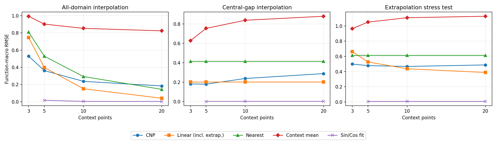
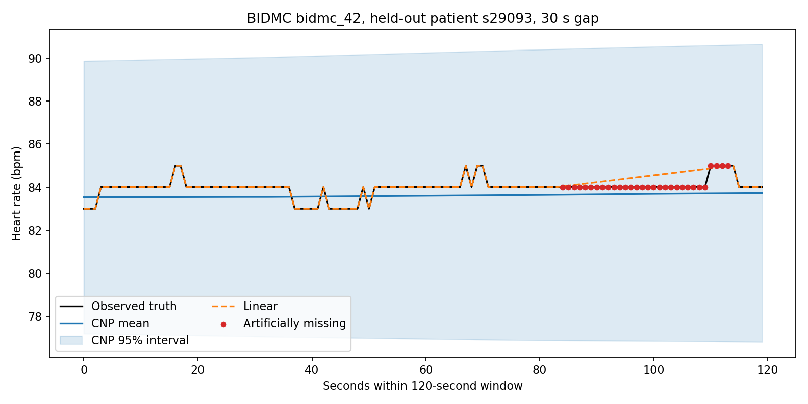

# CNPSim1: heart-rate interpolation with a standalone CNP

`myunusseker/CNMP`からmovement固有部分を外し、Conditional Neural Process（CNP）の核を独立したPyTorch packageとして実装した研究用プロトタイプです。Sin/Cosの固定function bankによるsynthetic benchmarkと、BIDMCの時刻付き心拍数を使った患者非重複の欠損補間実験、学習済みcheckpoint、評価結果、macOSネイティブGUIを収録しています。

## 現状

パイプラインは成立しましたが、現在の基本CNPを心拍補間に採用する性能上の根拠はまだありません。

- Sin/Cos未知関数の全域補間は、Context 3→20でRMSE 0.5296→0.1829へ改善
- 中央Gap補間はContext 5のRMSE 0.1798が最良で、Context 20では0.2881へ悪化
- Sin/Cos benchmarkでもContext 20の中央Gapは線形補間0.2022に敗ける
- 高周波OOD、pure Sin/Cos間の精度差、予測区間校正は未解決
- BIDMC 53記録・46患者を患者単位で32 train / 7 validation / 7 testへ分割
- 学習データは36記録、144個の120秒窓、固有17,280 HR点（4.8時間）
- 実行はstep 1,000でearly stop、アプリが使うbest checkpointはstep 500
- bestまでに8,000個の人工欠損タスク、232,032 Target点分のlossを処理
- 未知のtest患者7人に対するCNPの患者macro MAEは0.678–0.775 bpm
- 線形補間は0.168–0.528 bpmで、全6条件でCNPより良好
- CNPは全6条件でContext平均にも劣る
- 95%予測区間のcoverageは約99.8–100%、平均幅は約13.2 bpmで過度に保守的

どちらも固定split・1 seedの研究用PoCであり、臨床性能を示すものではありません。Sin/Cosの入力、学習量、固定評価、全結果は[Sin/Cos benchmark](docs/SINCOS_BENCHMARK.md)にまとめています。心拍側の正確な学習量、論文との比較、既知課題、次の実験は[学習監査と課題](docs/TRAINING_AUDIT.md)、実験条件と全MAE表は[BIDMC実験記録](docs/BIDMC_EXPERIMENT.md)を参照してください。





## 収録内容

- `src/cnp/`: deterministic CNP、Gaussian NLL、sampling、BIDMC adapter
- `src/cnp/synthetic.py`: Sin/Cos parameter bank、固定評価task、metrics、baseline
- `examples/train_sincos.py`: synthetic学習、未知関数評価、可視化
- `outputs/sincos/`: best checkpoint、全評価値、学習曲線、Context曲線
- `examples/train_bidmc.py`: 学習・患者macro評価・補間baseline比較
- `outputs/bidmc/best_model.pt`: step 500の学習済みcheckpoint
- `outputs/bidmc/results.json`: 設定、split、学習履歴、全評価値
- `apps/bidmc_desktop.py`: 任意Queryを指定できるTkinterデスクトップGUI
- `scripts/download_bidmc.py`: PhysioNet公式ファイルの取得とSHA256検証
- `tests/`: model、sampling、dataset、GUI runtimeの単体テスト
- `docs/EXTRACTION_NOTES.md`: CNMPから何を残し、何を外したか

生のBIDMC CSVはリポジトリに含めません。`data/bidmc/`にはライセンス、公式README、検証用manifestだけを収録しています。

## セットアップ

```bash
git clone https://github.com/yuta4869/CNPSim1.git
cd CNPSim1
python3 -m venv .venv
source .venv/bin/activate
python -m pip install -e '.[app]'
```

テスト:

```bash
python -m unittest discover -s tests -v
```

## BIDMCデータの取得

PhysioNetのBIDMC v1.0.0から、1 Hzの心拍数CSVと患者メタデータだけを取得します。

```bash
python scripts/download_bidmc.py
```

ダウンローダーは`data/bidmc/SHA256SUMS.txt`を使って全ファイルを検証します。

## 学習の再実行

Sin/Cos synthetic benchmark:

```bash
python examples/train_sincos.py --device auto
```

既定では4,096 train functions、256 validation、256 ID test、256 frequency-OOD、pure Sin/Cos各128本を固定します。各stepで64関数、関数ごとにContext 3〜20点、Query 32点をsampleし、最大10,000 steps学習します。全域補間、中央Gap補間、外挿stressをContext数別に評価し、結果を`outputs/sincos/`へ保存します。

BIDMC:

```bash
python examples/train_bidmc.py --device auto
```

既定では、ランダム欠損10/30/50%と連続欠損5/15/30秒を学習・評価し、線形補間、最近傍、Context平均と比較します。生成物は`outputs/bidmc/`に保存されます。現在収録している結果を上書きしたくない場合は`--output-dir`で別フォルダーを指定してください。

収録結果はPython 3.10.20、PyTorch 2.13.0、macOS 15.7.4 arm64、Apple MPSで生成しました。依存versionはlockしておらず、MPSを含む実行環境差があるため、同じseedでもbest stepや最終数値の完全一致は保証しません。コマンドはデータ処理・学習・評価パイプラインの再実行用です。

短い汎用CNP例:

```bash
python examples/toy_regression.py --steps 500 --device auto
```

## デスクトップアプリ

ブラウザやWebサーバーは使いません。患者、記録、120秒窓、Query時刻、人工的な連続欠損幅を選び、CNP平均、pointwise 95%区間、正解HR、線形補間を比較できます。

```bash
python apps/bidmc_desktop.py
```

既定checkpointは同梱されていますが、患者波形を表示するため先にBIDMCデータを取得してください。初期表示は学習に使っていないtest患者です。Queryの正解HRは評価表示だけに使われ、CNP入力には渡りません。

GUIでは30秒を超える欠損も指定できますが、現在のcheckpointが学習した連続欠損は5・15・30秒だけです。31〜60秒は学習分布外として警告されます。未来予測は未学習です。

Finderから起動する軽量macOSランチャー:

```bash
zsh scripts/build_macos_app.sh
open 'dist/BIDMC CNP Query Explorer.app'
```

この`.app`はリポジトリ内の`.venv`とソースを起動するランチャーです。単体配布パッケージではないため、`dist`から移動せず使用してください。必要ならビルド時に`CNP_PYTHON=/path/to/python zsh scripts/build_macos_app.sh`としてPython executableを埋め込めます。

## 最小API

```python
import torch
from cnp import CNP, gaussian_nll

model = CNP(x_dim=1, y_dim=1)
context_x = torch.tensor([[-1.0], [0.0], [1.0]])
context_y = torch.sin(context_x)
target_x = torch.linspace(-2.0, 2.0, 100).unsqueeze(-1)

mean, scale = model(context_x, context_y, target_x)
loss = gaussian_nll(mean, scale, torch.sin(target_x))
```

batched inputは`[B, C, x_dim]`, `[B, C, y_dim]`, `[B, T, x_dim]`です。batch内でContext数が異なる場合は`context_mask=[B, C]`を渡せます。

## 抽出境界

CNPとして残したのは`(context_x, context_y, target_x) -> (mean, scale)`、Contextの順序不変性、可変Context数、複数Query、Gaussian NLLです。軌道、sensorimotor、goal conditioning、ロボットfeedback/control、上流データは含めていません。

参照:

- M. Y. Seker et al., [Conditional Neural Movement Primitives](https://doi.org/10.15607/RSS.2019.XV.071), RSS 2019
- M. Garnelo et al., [Conditional Neural Processes](https://proceedings.mlr.press/v80/garnelo18a.html), ICML 2018
- Upstream implementation: <https://github.com/myunusseker/CNMP>
- BIDMC dataset: <https://physionet.org/content/bidmc/1.0.0/>

上流repositoryには確認時点で明示的なlicense fileがありません。本実装は上流ファイルのコピーではなく、論文のCNP構造と公開された挙動に基づく独立実装です。BIDMC由来ファイルの条件は`data/bidmc/LICENSE`を参照してください。なお、このリポジトリのコード自体には、現時点でプロジェクトレベルのライセンスが指定されていません。
