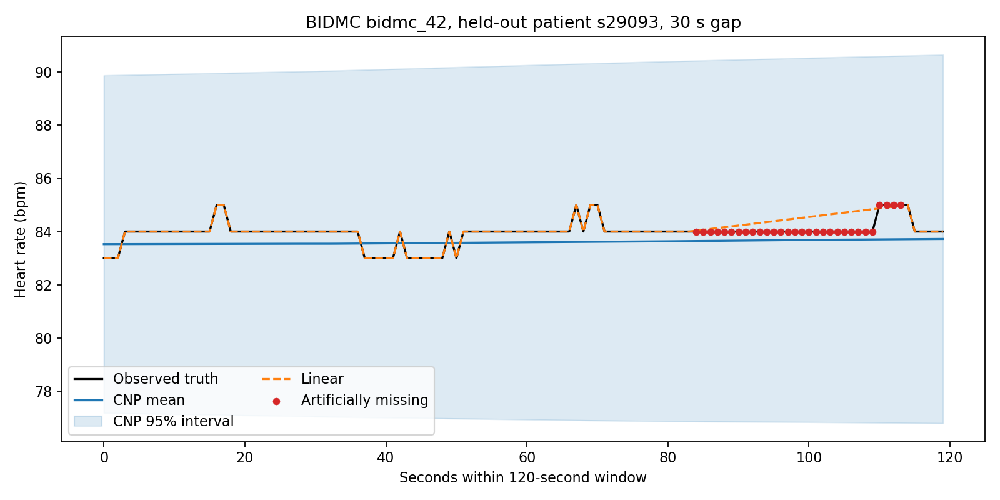

# BIDMC心拍数欠損補間実験

## 結論

BIDMCの時刻付き心拍数を使い、未知患者に対する欠損補間まで一通り実行できました。一方、この実験ではCNPのMAEは単純な線形補間・最近傍補間より大きくなりました。CNPが動かなかったのではなく、平均集約型CNPがContext全体を固定長表現へ圧縮するのに対し、線形補間はQuery直近の観測値を直接利用できるためです。

## データ

- Source: [BIDMC PPG and Respiration Dataset v1.0.0](https://physionet.org/content/bidmc/1.0.0/)
- License: Open Data Commons Attribution License v1.0
- 使用列: `Time [s]`, `HR`
- 53 recordings / 46 unique MIMIC patient IDs
- 各記録481点、HRは1 Hz
- HR範囲: 44–139 bpm
- 自然欠損: 全25,493点中4点。`bidmc_27`の207–210秒のみ

同一患者の複数記録は以下です。

- `s03386`: `bidmc_06`–`bidmc_09`
- `s11342`: `bidmc_20`–`bidmc_23`
- `s25323`: `bidmc_38`–`bidmc_39`

自然欠損には正解がないため、lossや評価targetには使っていません。NaNを含む120秒窓を1本除外し、正解のある点へ人工欠損を作りました。

## 実験設計

- Split seed: 7
- 患者単位split: 32 train / 7 validation / 7 test
- 非重複120秒窓: 144 train / 40 validation / 27 test
- 時刻: 各窓の先頭・末尾を`[-1, 1]`へ正規化
- HR: train患者だけでglobal標準化
  - mean: 90.777025 bpm
  - population std: 14.289872 bpm
- Batch sampling: 患者を一様sampleし、その患者の窓を一様sample
- Model: hidden 64、representation 64
- Optimizer: Adam、learning rate `1e-3`、gradient clipping `1.0`
- 最大1,500 steps、validation patience 5、1,000 stepsでearly stop
- 学習loss: Gaussian NLL
- Best checkpoint: step 500（欠損補間の主目的に合わせvalidation MAEで選択）

採用checkpointまでに500回のparameter update、8,000個の「120秒窓＋人工欠損」タスク、232,032 Target点分のlossを処理しました。これは独立データ数ではなく、17,280個の固有HR値を異なるmaskで再利用した回数です。詳細は[学習監査](TRAINING_AUDIT.md)にあります。

学習・評価mask:

- ランダム欠損: 10%、30%、50%。窓の両端はContextに残す
- 連続欠損: 5秒、15秒、30秒。両側に最低5秒のContextを残す
- Testは各条件5反復
- 主指標は患者macro MAE/RMSE

## Test結果

患者macro MAE、単位はbpmです。

| 人工欠損 | CNP | 線形補間 | 最近傍 | Context平均 |
|---|---:|---:|---:|---:|
| Random 10% | 0.683 | 0.168 | 0.169 | 0.576 |
| Random 30% | 0.678 | 0.175 | 0.172 | 0.573 |
| Random 50% | 0.690 | 0.189 | 0.183 | 0.583 |
| Gap 5秒 | 0.694 | 0.222 | 0.204 | 0.613 |
| Gap 15秒 | 0.775 | 0.372 | 0.365 | 0.678 |
| Gap 30秒 | 0.683 | 0.528 | 0.524 | 0.589 |

CNPの患者macro RMSEは条件により0.873–0.981 bpmでした。95%予測区間coverageは約99.8–100%、平均区間幅は約13.2 bpmで、MAE選択checkpointの区間はかなり広めです。不確実性を主目的にする場合は`--selection-metric nll`で別checkpointを選ぶべきです。



## 解釈

BIDMCの1 Hz心拍数は短時間では変化が小さく、欠損の前後にある値を結ぶだけで高精度になります。今回のCNPは、各`(time, HR)`をencodeした後に全Contextを単純平均するため、Query近傍のHRを明示的には参照しません。実際の予測平均は窓の代表的な心拍数に近くなり、局所変化では線形・最近傍補間が有利でした。

したがって現時点の結果は、次のように扱うのが適切です。

1. CNP学習・未知患者への補間パイプラインは成立した。
2. このデータ・欠損条件では、基本CNPを採用する性能上の根拠はまだない。
3. 次は患者GroupKFoldで再確認する。
4. CNP系を続ける場合は、Queryから各Contextを直接参照できるAttentive CNPとの比較が重要。

この結果は研究用の一回の固定splitであり、臨床性能を示すものではありません。

追加の既知課題:

- 1固定split・1 seedで、患者間ばらつきの信頼区間がない
- 学習患者は32人で、短時間のICU記録だけ
- 自然欠損は4点しかなく、評価のほぼすべてが人工欠損
- 基本CNPはQueryごとのContext attentionを持たない
- 学習した連続欠損は最大30秒で、GUIの31〜60秒は分布外
- 患者ID、属性、PPGなどはモデル入力に含めていない
- 未来予測は未学習
- hyperparameter、window長、model容量の系統的比較がない

## 再現

```bash
cd CNPSim1
source .venv/bin/activate
python scripts/download_bidmc.py
python examples/train_bidmc.py --device auto
```

生成物:

- `outputs/bidmc/best_model.pt`
- `outputs/bidmc/results.json`
- `outputs/bidmc/example_gap30.png`
