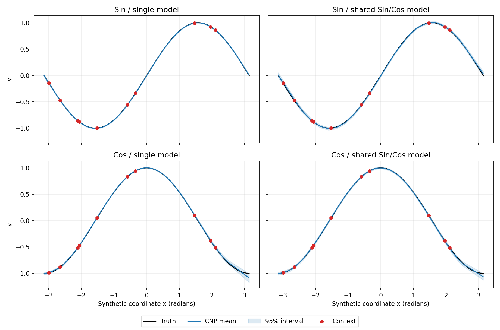

# Canonical Sin/Cos CNP sanity check

## 結論

固定した既知関数だけを使う3段階のsanity checkは、事前に決めた全gateを通過しました。

1. `single_sin`: 1つのCNPを `y=sin(x)` だけで学習
2. `single_cos`: 1つのCNPを `y=cos(x)` だけで学習
3. `sin_cos_pair`: 1つの共有CNPをSin/Cos両方で学習し、functionラベルを与えずContextから識別

Context=10、100通りの固定Context抽選に対するdense-grid結果です。

| Suite | Mean RMSE | Function別Context-draw p95のmacro平均 | Gate |
|---|---:|---:|---|
| Single Sin | 0.00369 | 0.00408 | PASS |
| Single Cos | 0.01125 | 0.01193 | PASS |
| Shared Sin/Cos | 0.01001 | 0.01478 | PASS |

共有モデルに反対側のfunctionのContext Yを入れるとRMSEはSin `0.9984`、Cos `1.0012`まで悪化しました。正しいContextとの差はそれぞれ`0.9885`、`0.9911`で、gateの`>0.8`を通過しています。したがって、共有モデルはQuery Xだけから平均波形を出しているのではなく、Context `(X,Y)`を使ってSin/Cosを切り替えています。

これはCNPの基本経路がこの単純問題で正常に学習できた証拠です。ただし、心拍補間性能、未知の波形への一般化、未来予測の証拠ではありません。



## 論文との関係

Sin/Cosそのものは、CNP原論文またはCNMP論文の実験には使われていません。

- CNP原論文の最初の1D regressionは、exponential kernelのGaussian Processからsampleした関数群と、kernel parameterを途中で切り替える関数群です。
- CNMP論文の最初のsimulationは、上下2 modeの2D obstacle-avoidance trajectoryです。
- CNMP公開NotebookにはGaussian bell-shaped trajectory familyもあります。

したがって正確な説明は、「論文も既知のsynthetic function/trajectory familyから検証を始めた。今回のSin/Cosはそれをさらに単純化した独自の実装sanity check」です。

参照:

- Garnelo et al., [Conditional Neural Processes](https://proceedings.mlr.press/v80/garnelo18a.html), ICML 2018
- Seker et al., [Conditional Neural Movement Primitives](https://doi.org/10.15607/RSS.2019.XV.071), RSS 2019

## 入力と学習

関数とdomainは次に固定しています。

\[
x\in[-\pi,\pi],\qquad y\in\{\sin(x),\cos(x)\}
\]

各optimizer step:

1. 64 function episodeをsampleする
2. 各episodeのContext数を3〜20から一様に選ぶ
3. Context Xと32個のQuery Xを`[-pi,pi]`から独立にsampleする
4. CNPへContext `(X,Y)`とQuery `X`だけを入力する
5. 隠したQuery `Y`をGaussian NLLの正解としてだけ使う
6. Adam、learning rate `1e-4`、gradient clip `1.0`で更新する

全modelはhidden 128、representation 128の同じdeterministic CNPです。各suiteを10,000 step学習したため、suiteごとの量は640,000 episode、20,480,000 Target loss点です。3 suite合計では1,920,000 episode、61,440,000 Target loss点です。

単一suiteはoptimizer/decoderを含む最小経路の切り分け用です。Contextを無視しても固定関数を暗記できるため、CNPの条件付けを証明するものではありません。共有Sin/Cos suiteとContext入替testが条件付けの最小確認です。

## 固定評価とgate

Context候補とQueryをinterleaved gridの別座標に置き、Context/Queryの重複を防いでいます。Context 3/5/10/20では同じseedを使い、小さいContext集合を大きい集合のsubsetにしています。testでは100個のContext seedを固定しました。

Context=10の必須gateは学習後の最終評価前に次へ固定しました。

- 各functionのmean RMSE `< 0.04`
- 各functionのContext-draw p95 RMSE `< 0.05`
- 共有モデルではwrong Context RMSE − correct Context RMSE `> 0.8`

共有モデルのContext数別macro mean RMSE:

| Context | 3 | 5 | 10 | 20 |
|---:|---:|---:|---:|---:|
| RMSE | 0.02022 | 0.01382 | 0.01001 | 0.00836 |

未学習時の共有モデルはContext=10でRMSE `0.7034`、学習後は`0.0100`です。予測区間の95% coverageはSin `0.9916`、Cos `0.9837`ですが、noiselessな固定関数であり、これを一般的な不確実性校正の証拠とは扱いません。

## 最初の不合格runからの修正

最初の探索runは`x=t in [0,1]`へ1周期を詰め込んだ`sin(2*pi*t) / cos(2*pi*t)`を使い、単一suiteを3,000 step、共有suiteを10,000 step学習しました。C=10 RMSEはSingle Sin `0.2743`、Single Cos `0.0567`、Shared `0.0433`で、strict gateは不合格でした。ただしSharedモデルのContext入替差は約`0.93〜0.99`で、Context経路は既に使われていました。

この設定は、入力Xに対する勾配の最大値が標準形`sin(x)`の6.28倍で、単純smoke testとして意図より難しく、単一モデルも上限時点で改善中でした。gateを緩めるのではなく、事前pilotと標準形へ条件を揃え、全suiteを10,000 stepへ延長して再実行しました。最初のrunは最終checkpointとして保存していません。

## GUI

Web serverやブラウザは使いません。外部datasetも不要です。

```bash
python apps/sanity_desktop.py
```

選択できるもの:

- Single Sin / Single Cos / Shared Sin+Cos checkpoint
- SinまたはCos（選択可能なsuiteのみ）
- Context数3〜20
- Context seed
- 任意のQuery X

表示するもの:

- CNP meanとpointwise 95%区間
- CNPへ渡したContext
- Query地点のPrediction、SD、正解、絶対誤差
- 全Query RMSE
- 保存checkpointのfixed-test PASS/FAIL

function選択は正解波形とContextを生成するためだけに使います。model forwardへ渡るのはContext `(X,Y)`とQuery `X`だけで、functionラベルとQuery truth `Y`は渡りません。

Finder用launcher:

```bash
zsh scripts/build_sanity_macos_app.sh
open 'dist/Canonical CNP Sanity Explorer.app'
```

## 再実行と成果物

```bash
python examples/train_sanity.py --device auto
```

成果物:

- `outputs/sanity/best_models.pt`
- `outputs/sanity/results.json`
- `outputs/sanity/learning_curves.png`
- `outputs/sanity/context_sweep.png`
- `outputs/sanity/predictions.png`

全数値は`outputs/sanity/results.json`を正とします。このrunはPython 3.10.20、PyTorch 2.13.0、Apple MPS、seed 73で生成しました。1 seedの実装sanity checkであり、正式な性能比較には複数seedが必要です。
